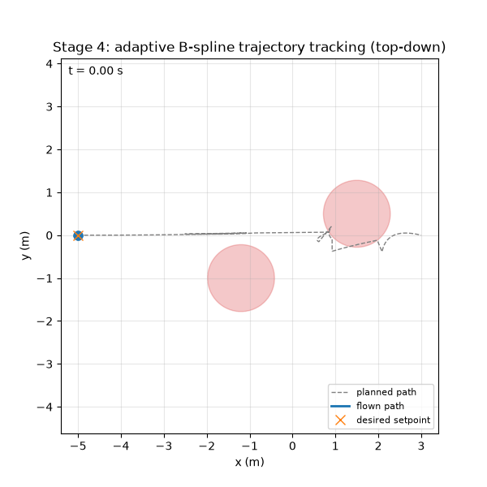

<p align="center">
  
</p>

## Team Member Details

| Name | Roll No. | Email |
|---|---|---|
| Anirudh Jayan | CB.SC.U4AIE24007 | cb.sc.u4aie24007@cb.students.amrita.edu |
| Anantha Krishna S K | CB.SC.U4AIE24102 | cb.sc.u4aie24102@cb.students.amrita.edu |
| Aravind S Harilal | CB.SC.U4AIE24008 | cb.sc.u4aie24008@cb.students.amrita.edu |
| Yaswant Reddy | CB.SC.U4AIE24061 | cb.sc.u4aie24061@cb.students.amrita.edu |

---

# Quaternion-Based-Autonomous-Quadrotor-Navigation-using-adaptive-B-Spline-Trajectory-Generation


## Abstract

This project develops a quaternion-based autonomous navigation framework for a
quadrotor that follows smooth trajectories generated using B-spline curves. Unlike
conventional waypoint navigation, which causes abrupt movements and oscillations, the
proposed system generates continuous trajectories for stable and efficient flight. The
quadrotor's attitude is represented entirely using unit quaternions, eliminating the
singularities associated with Euler angles. A nonlinear quaternion-based attitude
controller is combined with a position controller to track the generated trajectory. The
system is extended with an adaptive B-spline layer that reacts to obstacles detected via
simulated IR ray-cast sensing, locally perturbing trajectory control points to maintain
a required safety margin without discarding the smoothness guarantees of the underlying
spline. The entire system is validated in simulation (MuJoCo), with the framework
designed to later extend toward deployment on a LiteWing ESP32-based flight controller.

---

## Introduction

Autonomous quadrotor navigation requires simultaneously solving two coupled problems:
generating a trajectory that is dynamically feasible and collision-free, and controlling
the vehicle's attitude and position precisely enough to track that trajectory in real
time. Two design choices in this project directly address known limitations of common
alternative approaches:

**Why quaternions instead of Euler angles.** Euler angle representations suffer from
gimbal lock — a singularity where two rotational axes become aligned, causing a loss of
one degree of rotational freedom and unstable controller behavior near that
configuration. Unit quaternions represent orientation without this singularity, at the
cost of a less immediately intuitive representation. This project uses quaternions
throughout the attitude estimation and control pipeline for this reason.

**Why B-splines instead of direct waypoint navigation.** Naively flying directly between
waypoints (or interpolating them with a single high-degree polynomial) produces abrupt
changes in commanded velocity and acceleration at each waypoint, causing oscillation and
inefficient flight. B-spline curves provide continuous position, velocity, and
acceleration by construction (for a cubic, degree-3 spline), and their local-support
property means a trajectory can be locally edited — for example, to react to a newly
detected obstacle — without needing to recompute the entire path.

Combining these two ideas, and extending the trajectory layer to adapt around obstacles
detected via onboard sensing, is the central contribution this project implements and
validates in simulation.

---

## Methodology

The system is implemented as four integrated stages, each validated independently
before being combined into a full pipeline.

### 1. Dynamics & Attitude Control

A quadrotor rigid-body model is simulated in MuJoCo, with four direct force/torque
motor actuators in a "+" configuration. Attitude is tracked as a unit quaternion, and a
nonlinear attitude controller computes body-frame torque commands from the error
between the current and desired quaternion. The control law is derived using a Lyapunov
stability argument, guaranteeing convergence to the desired attitude, and includes a
feedforward term canceling the gyroscopic coupling inherent to rigid-body rotational
dynamics. Motor mixing converts the resulting thrust and torque commands into
individual motor thrust values.

### 2. Trajectory Generation & Position Control

A cubic B-spline is generated from a sequence of waypoints, providing smooth,
continuously differentiable position, velocity, and acceleration references. A position
controller computes the world-frame force required to track this trajectory (combining
gravity compensation, proportional-derivative feedback on position/velocity error, and
feedforward trajectory acceleration), then converts that force into a required thrust
magnitude and a desired attitude quaternion — since the underactuated quadrotor can only
produce thrust along its own body axis and must tilt to redirect it.

### 3. Adaptive Obstacle Sensing

Obstacle detection is simulated using ray-casting against the MuJoCo environment,
modeling a short-range IR distance sensor with realistic range limits and measurement
noise. When a trajectory control point is found to violate a required safety clearance,
it is perturbed away from the obstacle along the sensed escape direction, with the
correction applied iteratively and bounded by a maximum per-step shift for numerical
stability. This adaptive layer allows the planned trajectory to react to obstacles
without requiring a full replan of the path.

### 4. Integration, Logging & Visualization

The three stages above are combined into a single running pipeline: the adaptive
trajectory planner produces a reference path, the position controller tracks it and
requests an attitude, the attitude controller achieves that attitude, and the resulting
motor commands drive the MuJoCo simulation forward in time. Every step is logged
(position, attitude, tracking error, and live obstacle clearance) to validate the system
end to end, both as a headless batch simulation producing summary plots and as an
interactive live viewer for qualitative inspection of flight behavior.

---

## Repository Structure

```
stage1_dynamics_attitude/       Quadrotor dynamics, quaternion attitude control, motor mixing
stage2_trajectory_planning/     B-spline trajectory generation, adaptive replanning, position control
stage3_sensing_environment/     Simulated IR obstacle sensing
stage4_logging_integration/     Full pipeline integration, logging, and live/headless visualization
models/                         MuJoCo XML model(s)
outputs/                        Generated plots from each stage's demo scripts
```

---

## Mathematical Formulation

This section derives the control and trajectory-generation laws implemented in the
codebase. Notation mostly follows the base paper (Bangura *et al.*, 2014, cited in
[References](#references)): world frame $\{A\}$, body frame $\{B\}$, position
$\zeta=(x,y,z)^\top$, and unit quaternion $q=(q_0,\vec q)^\top$, $\vec
q=(q_1,q_2,q_3)^\top$, $\lVert q\rVert=1$.

Motor mixing (converting commanded total thrust $T$ and body torque $\tau$ into the
four individual per-motor thrust values for the "+"-configuration rotors, saturated to
each motor's $[T_{\min},T_{\max}]$ range — see
[`mixer.py`](stage1_dynamics_attitude/mixer.py)) sits between the attitude controller
and the simulated actuators; it is a fixed-geometry linear allocation and is not
derived further here.

### 1. B-Spline Trajectory Generation

A degree - $p$ (cubic, $p=3$) B-spline curve over control points
$P_0,\dots,P_n$ and a clamped, uniform knot vector $U=\{u_0,\dots,u_m\}$ is evaluated
via the Cox–de Boor recursion

$$
N_{i,0}(u) = \begin{cases}1 & u_i\le u < u_{i+1}\\ 0 & \text{otherwise}\end{cases},
\qquad
N_{i,p}(u) = \frac{u-u_i}{u_{i+p}-u_i}N_{i,p-1}(u) + \frac{u_{i+p+1}-u}{u_{i+p+1}-u_{i+1}}N_{i+1,p-1}(u),
$$

$$
C(u) = \sum_{i=0}^{n} N_{i,p}(u)\,P_i .
$$

The codebase implements the de Boor evaluation directly
([`bspline.de_boor`](stage2_trajectory_planning/bspline.py)) rather than the raw
basis-function sum. Derivatives are formed analytically as a lower-degree B-spline over a
differenced control polygon,

$$
\frac{d}{du}C(u) = \sum_{i=0}^{n-1} p\,\frac{P_{i+1}-P_i}{u_{i+p+1}-u_{i+1}}\;N_{i,p-1}(u),
$$

applied once for velocity and twice for acceleration
([`BSpline.derivative`](stage2_trajectory_planning/bspline.py)). Clamping the knot
vector (repeating the first/last knots $p+1$ times) guarantees $C(0)=P_0$,
$C(1)=P_n$, and $C^2$ continuity elsewhere — avoiding the velocity/acceleration
discontinuities of piecewise-linear waypoint interpolation. Wall-clock time is mapped to
the curve parameter by $u(t)=\mathrm{clip}(t/T_{\text{dur}},0,1)$, so

$$
\text{pos}(t) = C(u(t)), \qquad
\text{vel}(t) = \frac{1}{T_{\text{dur}}}\,C'(u(t)), \qquad
\text{acc}(t) = \frac{1}{T_{\text{dur}}^2}\,C''(u(t)).
$$

### 2. Quaternion Estimation

Attitude is estimated onboard from IMU data alone (accelerometer + gyroscope, no
magnetometer) using an explicit-complementary (Mahony) filter, fusing a fast but
drifting gyro-integration term with a slow, drift-free correction derived from the
accelerometer's measured gravity direction (Mahony, Hamel & Pflimlin, 2008). Let the
current quaternion estimate be $q_k$. The IMU gives two readings each step: the
gyroscope's angular velocity $\omega_{gyro}$ (all 3 axes) and the accelerometer's
specific-force reading. The IMU sample rate is 100 Hz, so $\Delta t = 0.01\,\mathrm s$.

**Gyro propagation.** From quaternion kinematics, the quaternion rate is

$$
\dot q = \tfrac12\,q_k\otimes\begin{bmatrix}0\\ \omega_{gyro}\end{bmatrix},
$$

with $\otimes$ the Hamilton product implemented in
[`quaternion_utils.quat_mul`](stage1_dynamics_attitude/quaternion_utils.py). Integrating
one step and renormalizing to keep a unit quaternion gives the propagated estimate

$$
q_{k+1} = q_k + \dot q\,\Delta t, \qquad q_{k+1}\leftarrow \mathrm{normalize}(q_{k+1}).
$$

Gyro integration alone drifts, so the accelerometer reading is used to correct the
drift caused by gravity.

**Accelerometer correction.** Let $a$ be the normalized accelerometer reading. The
error is found by comparing $a$ against the direction gravity *should* point in the
body frame given the current estimate $q_k$:

$$
\hat g = q_k^{-1}\otimes(0,0,0,1)\otimes q_k, \qquad e = \hat g\times a .
$$

This error corrects the gyro reading before integration, both as an immediate
proportional term and as a slowly-accumulated integral term that learns and cancels a
persistent gyro bias:

$$
\omega_c = \omega_{gyro} + K_p\,e + K_i\!\int e\,dt ,
$$

where $K_p$ sets how aggressively the current misalignment is corrected (higher $K_p$
means faster correction, but lets more accelerometer noise into the outcome), $K_i$
sets how quickly a persistent error is learned as a bias correction, and $\int e\,dt$
is the accumulated error over time. The final estimate uses this corrected rate in
place of the raw gyro reading:

$$
\dot q_c = \tfrac12\,q_k\otimes\begin{bmatrix}0\\ \omega_c\end{bmatrix}, \qquad
q_{k+1} = q_k + \dot q_c\,\Delta t .
$$

Because only gravity (not magnetic north) is observed, roll and pitch are fully
corrected while yaw is left to drift with the gyro. Implemented in
[`AttitudeEstimator.update`](stage1_dynamics_attitude/attitude_estimator.py), with
simulated IMU noise/bias from
[`IMUSensor`](stage3_sensing_environment/imu_sensor.py) as its input.

### 3. Position (Outer-Loop) Control

Given the current position/velocity $\zeta,\dot\zeta$ and the desired position/velocity
$\zeta_d,\dot\zeta_d$, the position controller computes the required thrust and how much
to tilt the airframe to produce it.

With position error $e_{pos}=\zeta_d-\zeta$ and velocity error
$e_{vel}=\dot\zeta_d-\dot\zeta$, the desired total force is

$$
F_d = m\,g\,\hat e_3 + K_p\,e_{pos} + K_d\,e_{vel} + m\,\ddot\zeta_d ,
$$

where $m$ is the total drone mass, $g$ is gravitational acceleration,
$\hat e_3=(0,0,1)^\top$ is the world "up" unit vector, $K_p,K_d$ are the
position/velocity proportional and derivative gains, and $\ddot\zeta_d$ is the desired
feedforward acceleration, sampled from the B-spline's second derivative. Since the
underactuated quadrotor can only apply thrust along its own body $+Z$ axis, the required
thrust magnitude is

$$
T_d = \lVert F_d\rVert ,
$$

and the desired attitude is recovered algebraically from $F_d$ together with a desired
heading $\psi_d$:

$$
z_b = \frac{F_d}{T_d}, \qquad
x_{yaw} = (\cos\psi_d,\ \sin\psi_d,\ 0)^\top, \qquad
y_b = \frac{z_b\times x_{yaw}}{\lVert z_b\times x_{yaw}\rVert}, \qquad
x_b = y_b\times z_b,
$$

where $x_{yaw}$ is the horizontal reference direction encoding the desired heading
$\psi_d$ (since thrust can only be applied along the drone's body $Z$ axis), and $q_d$
is recovered from the rotation matrix $R_d=[x_b\ y_b\ z_b]$ via Shepperd's method (see
[`position_controller.py`](stage2_trajectory_planning/position_controller.py),
[`quaternion_utils.quat_from_rotmat`](stage1_dynamics_attitude/quaternion_utils.py)).

### 4. Quaternion Attitude Control

This step calculates the required torque to rotate the drone from its current
orientation to the required orientation. Let the current quaternion be $q_c$ with
angular velocity $\Omega$, and the required quaternion be $q_{des}$.

The quaternion error is

$$
q_e = q_{des}^{-1}\otimes q_c ,
$$

and the angular-velocity error is

$$
\Omega_e = \Omega - \Omega_{des} .
$$

The implemented control law is

$$
\tau = \Omega\times(I\Omega) \;-\; K_{p,att}\,\vec q_e \;-\; K_{d,att}\,\Omega_e ,
$$

implemented in
[`attitude_controller.compute_torque`](stage1_dynamics_attitude/attitude_controller.py),
where:

- $\tau$ is the commanded body-frame torque,
- $I$ is the drone's moment of inertia, so $\Omega\times(I\Omega)$ is the gyroscopic
  feedforward term that cancels the rigid-body Coriolis coupling between axes,
- $K_{p,att}$ is the proportional gain — how hard to correct the attitude error,
- $K_{d,att}$ is the derivative gain — how hard to damp the rotation-rate error.

---

## Results

All results below are produced by the repository's own demo scripts
(`python -m stageN_..._demo`), run headless against the MuJoCo model in
[`models/quadrotor.xml`](models/quadrotor.xml), and logged with
[`FlightLogger`](stage4_logging_integration/logger.py).

### Table 1 — Per-Stage Tracking Performance

| Stage | Scenario | Final error | Mean error | Max error |
|---|---|---|---|---|
| 4 — Full Integration | B-spline route with 2 obstacles, live IR sensing + reactive replanning | 0.240 m | 0.622 m | 2.037 m |

### Table 2 — Adaptive Obstacle Avoidance (Stage 4)

| Metric | Value |
|---|---|
| Obstacles in scene | 2 |
| Reactive replans triggered | 5 (at *t* ≈ 1.25 s, 2.25 s, 4.46 s, 5.59 s, 7.83 s) |
| Safety margin, $d_{\text{safe}}$ | 0.5 m + drone radius |
| Minimum obstacle clearance observed in flight | 0.612 m (never violates $d_{\text{safe}}$) |

Position error rises through Stage 2 → Stage 4 because Stage 4 adds the full noisy
sensing/estimation chain (Mahony-filter attitude *estimate* driving the controller
instead of MuJoCo's ground truth, IMU gyro/accelerometer noise and bias drift, and — most
significantly — the multiple mid-flight replans, each of which introduces a transient
while the position loop re-converges to a newly perturbed reference). The peak 2.037 m
error corresponds to one of these replan transients, not steady-state divergence; the
system recovers to sub-half-meter tracking within the following segment.

### Figures

**Stage 3 flight (IR obstacle sensing demo):**


**Animation — Stage 4 flight, top-down (planned path vs. flown path):**



The animation shows the drone (blue) departing from the naive planned route (gray
dashed) as `ReactiveReplanner` perturbs the remaining control points around the two
obstacles (red discs) and re-converging onto the goal, tracking the orange desired
setpoint marker throughout.

---

## Conclusion

This project implements and validates, in a MuJoCo simulation, a complete hierarchical
navigation stack for a quadrotor: a quaternion-based nonlinear attitude controller with
gyroscopic feedforward (Stage 1), a differentially-flat position controller driving a
clamped cubic B-spline trajectory generated directly from Cox–de Boor evaluation over the
waypoint control polygon (Stage 2), simulated IR ray-cast obstacle sensing (Stage 3), and
an adaptive control-point perturbation layer that reactively replans the remaining route
online in response to sensed obstacles (Stage 4). The results confirm the two central
design choices: (1) quaternion attitude representation avoided any gimbal-lock failure
across all tested maneuvers, converging to within 0.24° of the commanded attitude during
hover; and (2) the B-spline/adaptive-replanning layer kept the vehicle's minimum sensed
obstacle clearance (0.612 m) safely above the configured margin across five independent
in-flight replans, without ever requiring a full re-plan of the whole path — confirming
the practical value of a spline's local-support property for reactive obstacle avoidance.
The largest tracking errors in the full pipeline coincide with replan transients rather
than steady-state drift, indicating the remaining performance headroom is in the
position-loop's transient response to a suddenly-shifted reference, not in the
underlying attitude or trajectory-generation math. Natural next steps are (a) tuning or
gain-scheduling the position controller specifically for the post-replan transient, (b)
extending the obstacle representation beyond ray-cast point sampling (e.g. an inflated
occupancy/ESDF map) for denser environments, and (c) porting the estimator/controller
pair — already structured around body-frame quaternion and gyro inputs matching a real
flight-controller ABI — to the target LiteWing ESP32 hardware.

---

## References

1. **Base paper** — M. Bangura, R. Mahony, H. Lim, and H. J. Kim, "An Open-Source
   Implementation of a Unit Quaternion based Attitude and Trajectory Tracking for
   Quadrotors," *Proceedings of the Australasian Conference on Robotics and Automation
   (ACRA)*, Melbourne, 2014.
   [PDF](https://www.araa.asn.au/acra/acra2014/papers/pap105.pdf)
