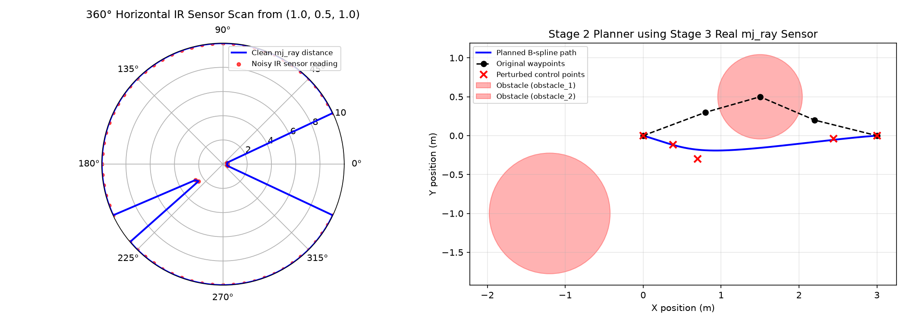
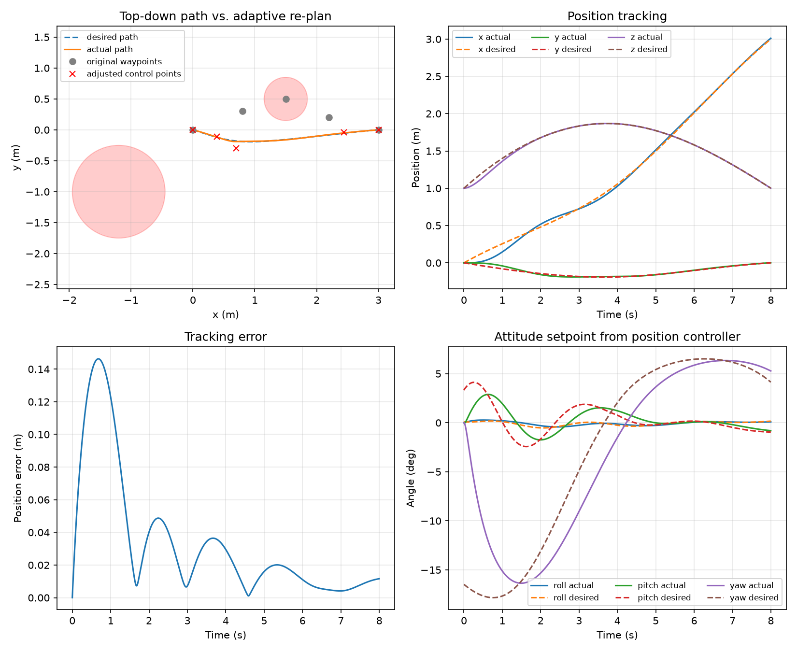

<p align="center">
  
</p>

## Team Member Details

| Name | Roll No. | Email |
|---|---|---|
| Anirudh Jayan | CB.SC.U4AIE24007 | cb.sc.u4aie24007@cb.students.amrita.edu |
| Anantha Krishna S K | CB.SC.U4AIE24102 | cb.sc.u4aie24102@cb.students.amrita.edu |
| Aravind S Harilal | CB.SC.U4AIE24008 | cb.sc.u4aie24008@cb.students.amrita.edu |
| Yaswanth Reddy | CB.SC.U4AIE24061 | cb.sc.u4aie24061@cb.students.amrita.edu |

---

# Quaternion-Based-Autonomous-Quadrotor-Navigation-using-adaptive-B-Spline-Trajectory-Generation


## Abstract

This project develops a quaternion-based autonomous navigation framework for a
quadrotor that follows smooth trajectories generated using B-spline curves. Unlike
conventional waypoint navigation, which causes abrupt movements and oscillations, the
proposed system generates continuous trajectories for stable and efficient flight. The
quadrotor's attitude is represented entirely using unit quaternions, eliminating the
singularities associated with Euler angles. A nonlinear quaternion-based attitude
controller is combined with a position controller to track the generated trajectory. The
system is extended with an adaptive B-spline layer that reacts to obstacles detected via
simulated IR ray-cast sensing, locally perturbing trajectory control points to maintain
a required safety margin without discarding the smoothness guarantees of the underlying
spline. The entire system is validated in simulation (MuJoCo), with the framework
designed to later extend toward deployment on a LiteWing ESP32-based flight controller.

---

## Introduction

Autonomous quadrotor navigation requires simultaneously solving two coupled problems:
generating a trajectory that is dynamically feasible and collision-free, and controlling
the vehicle's attitude and position precisely enough to track that trajectory in real
time. Two design choices in this project directly address known limitations of common
alternative approaches:

**Why quaternions instead of Euler angles.** Euler angle representations suffer from
gimbal lock — a singularity where two rotational axes become aligned, causing a loss of
one degree of rotational freedom and unstable controller behavior near that
configuration. Unit quaternions represent orientation without this singularity, at the
cost of a less immediately intuitive representation. This project uses quaternions
throughout the attitude estimation and control pipeline for this reason.

**Why B-splines instead of direct waypoint navigation.** Naively flying directly between
waypoints (or interpolating them with a single high-degree polynomial) produces abrupt
changes in commanded velocity and acceleration at each waypoint, causing oscillation and
inefficient flight. B-spline curves provide continuous position, velocity, and
acceleration by construction (for a cubic, degree-3 spline), and their local-support
property means a trajectory can be locally edited — for example, to react to a newly
detected obstacle — without needing to recompute the entire path.

Combining these two ideas, and extending the trajectory layer to adapt around obstacles
detected via onboard sensing, is the central contribution this project implements and
validates in simulation.

---

## Methodology

The system is implemented as four integrated stages, each validated independently
before being combined into a full pipeline.

### 1. Dynamics & Attitude Control

A quadrotor rigid-body model is simulated in MuJoCo, with four direct force/torque
motor actuators in a "+" configuration. Attitude is tracked as a unit quaternion, and a
nonlinear attitude controller computes body-frame torque commands from the error
between the current and desired quaternion. The control law is derived using a Lyapunov
stability argument, guaranteeing convergence to the desired attitude, and includes a
feedforward term canceling the gyroscopic coupling inherent to rigid-body rotational
dynamics. Motor mixing converts the resulting thrust and torque commands into
individual motor thrust values.

### 2. Trajectory Generation & Position Control

A cubic B-spline is generated from a sequence of waypoints, providing smooth,
continuously differentiable position, velocity, and acceleration references. A position
controller computes the world-frame force required to track this trajectory (combining
gravity compensation, proportional-derivative feedback on position/velocity error, and
feedforward trajectory acceleration), then converts that force into a required thrust
magnitude and a desired attitude quaternion — since the underactuated quadrotor can only
produce thrust along its own body axis and must tilt to redirect it.

### 3. Adaptive Obstacle Sensing

Obstacle detection is simulated using ray-casting against the MuJoCo environment,
modeling a short-range IR distance sensor with realistic range limits and measurement
noise. When a trajectory control point is found to violate a required safety clearance,
it is perturbed away from the obstacle along the sensed escape direction, with the
correction applied iteratively and bounded by a maximum per-step shift for numerical
stability. This adaptive layer allows the planned trajectory to react to obstacles
without requiring a full replan of the path.

### 4. Integration, Logging & Visualization

The three stages above are combined into a single running pipeline: the adaptive
trajectory planner produces a reference path, the position controller tracks it and
requests an attitude, the attitude controller achieves that attitude, and the resulting
motor commands drive the MuJoCo simulation forward in time. Every step is logged
(position, attitude, tracking error, and live obstacle clearance) to validate the system
end to end, both as a headless batch simulation producing summary plots and as an
interactive live viewer for qualitative inspection of flight behavior.

---

## Repository Structure

```
stage1_dynamics_attitude/       Quadrotor dynamics, quaternion attitude control, motor mixing
stage2_trajectory_planning/     B-spline trajectory generation, adaptive replanning, position control
stage3_sensing_environment/     Simulated IR obstacle sensing
stage4_logging_integration/     Full pipeline integration, logging, and live/headless visualization
stage5_pybullet_sim/            PyBullet physics backend & co-simulation
stage6_ardupilot_sim/           ArduPilot SITL integration & offboard MAVLink setpoint streaming
stage7_gazebo_sim/              Gazebo (gz-sim) physics backend, lockstep in-process co-simulation
models/                         MuJoCo XML model(s)
outputs/                        Generated plots from each stage's demo scripts

```

### Running Stage 7 (Gazebo)

Stage 7 flies the same Stage 1–3 stack and route as Stages 4 and 5 in Gazebo
(gz-sim Harmonic or newer). The controller runs inside gz-sim's PreUpdate callback
through the Python `TestFixture`, so it steps in lockstep with Gazebo's physics.
The Gazebo Python bindings are not on pip, and Gazebo has no stable Windows build,
so on Windows run Stage 7 inside WSL2 (Ubuntu 24.04):

```bash
sudo apt-get update && sudo apt-get install -y curl lsb-release gnupg
sudo curl https://packages.osrfoundation.org/gazebo.gpg --output /usr/share/keyrings/pkgs-osrf-archive-keyring.gpg
echo "deb [arch=$(dpkg --print-architecture) signed-by=/usr/share/keyrings/pkgs-osrf-archive-keyring.gpg] http://packages.osrfoundation.org/gazebo/ubuntu-stable $(lsb_release -cs) main" | sudo tee /etc/apt/sources.list.d/gazebo-stable.list > /dev/null
sudo apt-get update && sudo apt-get install -y gz-harmonic python3-gz-sim8 python3-gz-math7 python3-venv

# --system-site-packages so the venv can see the apt-installed gz bindings
python3 -m venv --system-site-packages .venv && source .venv/bin/activate
pip install mujoco numpy matplotlib pymavlink

python -m stage7_gazebo_sim.run_gazebo_demo             # headless, saves outputs/stage7_gazebo_*.png
python -m stage7_gazebo_sim.run_gazebo_demo --viewer    # real time, opens the Gazebo GUI
```

`main.py` skips Stage 5 or Stage 7 (with a message) when PyBullet or Gazebo isn't installed.

---

## Mathematical Formulation

This section derives the dynamics model, the controllers, the motor mixer, and the
data-driven (black-box) identification of the controlled plants used in the codebase.
Notation mostly follows the base paper (Bangura *et al.*, 2014, cited in
[References](#references)): world frame $\lbrace A\rbrace$ with the vertical axis pointing
up, body frame $\lbrace B\rbrace$, position $r=(x,y,z)^\top$, linear velocity $v=\dot r$,
body angular velocity $\Omega$, unit quaternion $q=(q_0,\vec q)^\top$ with
$\vec q=(q_1,q_2,q_3)^\top$ and $\lVert q\rVert=1$, mass $m$, inertia matrix
$J=\mathrm{diag}(J_{xx},J_{yy},J_{zz})$, and control period $\Delta t$. The subscript $k$
denotes the value at the $k$-th control step, $t=k\,\Delta t$.

### 1. B-Spline Trajectory Generation

A degree-$p$ (cubic, $p=3$) B-spline curve over control points $P_0,\dots,P_n$ and a
clamped, uniform knot vector $U=\lbrace u_0,\dots,u_m\rbrace$ is evaluated via the
Cox–de Boor recursion:

```math
N_{i,0}(u) = \begin{cases} 1 & u_i \le u < u_{i+1} \\ 0 & \text{otherwise} \end{cases}
```
```math
N_{i,p}(u) = \left(\frac{u-u_i}{u_{i+p}-u_i}\right)\,N_{i,p-1}(u) + \left(\frac{u_{i+p+1}-u}{u_{i+p+1}-u_{i+1}}\right)\,N_{i+1,p-1}(u)
```

```math
C(u) = \sum_{i=0}^{n} N_{i,p}(u)\,P_i
```

The codebase implements the de Boor evaluation directly
([`bspline.de_boor`](stage2_trajectory_planning/bspline.py)) rather than the raw
basis-function sum. Derivatives are formed analytically as a lower-degree B-spline over a
differenced control polygon,

```math
\frac{d}{du}C(u) = \sum_{i=0}^{n-1} p\,\frac{P_{i+1}-P_i}{u_{i+p+1}-u_{i+1}}\,N_{i,p-1}(u),
```

applied once for velocity and twice for acceleration
([`BSpline.derivative`](stage2_trajectory_planning/bspline.py)). Clamping the knot vector
(repeating the first and last knots $p+1$ times) guarantees $C(0)=P_0$, $C(1)=P_n$, and
$C^2$ continuity elsewhere. This avoids the velocity and acceleration discontinuities of
piecewise-linear waypoint interpolation. Wall-clock time is mapped to the curve parameter
by $u(t)=\mathrm{clip}(t/T_{\text{dur}},0,1)$, so

```math
r_{des}(t) = C(u(t)), \qquad v_{des}(t) = \frac{1}{T_{\text{dur}}}\,C'(u(t)), \qquad \ddot r_{des}(t) = \frac{1}{T_{\text{dur}}^2}\,C''(u(t)).
```

### 2. Quaternion Estimation

Attitude is estimated onboard from IMU data alone (accelerometer and gyroscope, no
magnetometer) using an explicit-complementary (Mahony) filter. It fuses a fast but
drifting gyro-integration term with a slow, drift-free correction derived from the
accelerometer's measured gravity direction (Mahony, Hamel & Pflimlin, 2008). Let the
current quaternion estimate be $q_k$. The IMU gives two readings each step: the
gyroscope's angular velocity $\omega_{gyro}$ (all three axes) and the accelerometer's
specific-force reading. The IMU sample rate is 100 Hz, so $\Delta t = 0.01\,\mathrm{s}$.

**Gyro propagation.** From quaternion kinematics, the quaternion rate is

```math
\dot q = \tfrac{1}{2}\, q_k \otimes \begin{bmatrix} 0 \\ \omega_{gyro} \end{bmatrix}
```

with $\otimes$ the Hamilton product implemented in
[`quaternion_utils.quat_mul`](stage1_dynamics_attitude/quaternion_utils.py). Integrating
one step and renormalising to keep a unit quaternion gives the propagated estimate

```math
q_{k+1} = q_k + \dot q\,\Delta t, \qquad q_{k+1} \leftarrow \mathrm{normalize}(q_{k+1})
```

Gyro integration alone drifts, so the accelerometer reading is used to correct the drift
using gravity.

**Accelerometer correction.** Let $a$ be the normalised accelerometer reading. The error
is found by comparing $a$ with the direction gravity *should* point in the body frame,
given the current estimate $q_k$:

```math
\hat g = q_k^{-1} \otimes (0,0,0,1) \otimes q_k, \qquad e = \hat g \times a
```

This error corrects the gyro reading before integration. It enters both as an immediate
proportional term and as a slowly accumulated integral term that learns and cancels a
persistent gyro bias:

```math
\omega_c = \omega_{gyro} + K_p\,e + K_i \int e\,dt
```

$K_p$ sets how aggressively the current misalignment is corrected (higher $K_p$ corrects
faster but lets more accelerometer noise into the estimate). $K_i$ sets how quickly a
persistent error is learned as a bias correction, and $\int e\,dt$ is the error
accumulated over time. The final estimate uses this corrected rate in place of the raw
gyro reading:

```math
\dot q_c = \tfrac{1}{2}\, q_k \otimes \begin{bmatrix} 0 \\ \omega_c \end{bmatrix}, \qquad q_{k+1} = q_k + \dot q_c\,\Delta t
```

Only gravity is observed, not magnetic north, so roll and pitch are fully corrected while
yaw is left to drift with the gyro. This is implemented in
[`AttitudeEstimator.update`](stage1_dynamics_attitude/attitude_estimator.py), with
simulated IMU noise and bias from
[`IMUSensor`](stage3_sensing_environment/imu_sensor.py) as its input.

### 3. Quadrotor Dynamics

**State representation.** The full state of the drone is

```math
x = \begin{bmatrix} r \\ v \\ \Omega \\ q \end{bmatrix}
```

where $r$ is the position vector, $v$ is the linear velocity vector, $\Omega$ is the
angular velocity vector, and $q$ is the attitude quaternion. Position and velocity describe
the translational motion; angular velocity and the quaternion describe the rotational
motion.

**Translational dynamics.** By Newton's second law, $m\ddot r = F_{thrust} + F_{gravity}$.
With the world vertical axis pointing up,

```math
m\ddot r = T\,z_b - m g\,e_3
```

where $T$ is the total thrust generated by the propellers, $z_b$ is the body vertical axis
expressed in world coordinates, $g$ is the acceleration due to gravity, and
$e_3=[0,\,0,\,1]^\top$ is the world vertical unit vector. Dividing by the mass gives

```math
\ddot r = \frac{T}{m}\,z_b - g\,e_3
```

Using a simple discrete-time velocity update, the thrust and gravity set the net
acceleration, which changes the drone's velocity at each time step:

```math
v_{k+1} = v_k + \Delta t \left( \frac{T_k}{m}\, z_{b,k} - g\,e_3 \right)
```

**Rotational dynamics.** The rotational motion is described by Euler's equation

```math
J\dot\Omega = \tau - \Omega \times (J\Omega)
```

where $J$ is the moment of inertia matrix and $\tau$ is the torque generated by the
motors. The term $\Omega\times(J\Omega)$ is the gyroscopic coupling between the axes.
Using an Euler update,

```math
\Omega_{k+1} = \Omega_k + \Delta t\, J^{-1} \left[ \tau_k - \Omega_k \times (J\Omega_k) \right]
```

This equation describes how the angular velocity changes under the applied torque and the
rotational coupling.

**Connection between the loops.** The quadrotor can produce thrust only along its own
$z_b$ axis. The position controller (§4) therefore computes the translational correction
as a force. The attitude controller (§5), acting through the rotational dynamics, turns
the drone so that its thrust produces that force.

### 4. Position (Outer-Loop) Control

The objective of the position controller is to make the quadrotor follow the trajectory
generated by the B-spline planner (§1). At each time step the planner provides the desired
position, velocity, and acceleration. The controller compares these reference values with
the actual state of the drone and computes corrective commands that reduce the tracking
error:

```
Trajectory  ──►  Error calculation  ──►  PD controller  ──►  Control command
```

**Position and velocity errors.**

```math
e_{pos} = r_{des} - r, \qquad e_{vel} = v_{des} - v, \qquad \dot e_{pos} = e_{vel}
```

Here $r_{des}$ and $v_{des}$ come from the B-spline planner, and $r$ and $v$ are the
drone's actual position and velocity. The velocity error matters because reaching the
correct position is not enough if the drone is moving too fast, too slowly, or in the
wrong direction.

**PD feedback terms.** The proportional term depends on the magnitude and direction of the
position error; a larger error produces a stronger corrective force, and $K_p$ sets its
strength. The derivative term depends on the velocity error; it helps the drone match the
desired velocity, reduces overshoot, and damps excessive motion, and $K_d$ sets its
strength.

```math
F_P = K_p\, e_{pos}, \qquad F_D = K_d\, e_{vel}
```

**Complete control law.** The commanded acceleration combines a feedforward term from the
trajectory planner with the feedback correction:

```math
\ddot r_{cmd} = \ddot r_{des} + \frac{1}{m} \left( K_p\, e_{pos} + K_d\, e_{vel} \right)
```

The first term is feedforward control: it anticipates the acceleration needed to follow
the planned trajectory. The second term is feedback control: it corrects the difference
between the desired and actual motion. The feedback terms are forces, so dividing by the
mass converts them to acceleration.

**Position error dynamics.** Differentiating the position error twice gives
$\ddot e_{pos} = \ddot r_{des} - \ddot r$. Assuming the attitude loop delivers the
commanded acceleration ($\ddot r = \ddot r_{cmd}$), the desired-acceleration terms cancel:

```math
\ddot e_{pos} = \ddot r_{des} - \left[ \ddot r_{des} + \frac{1}{m}\left( K_p\, e_{pos} + K_d\, e_{vel} \right) \right] = -\frac{1}{m} \left( K_p\, e_{pos} + K_d\, e_{vel} \right)
```

This equation describes the closed-loop evolution of the tracking error. With positive
gains it is a damped second-order system, with natural frequency
$\omega_n=\sqrt{K_p/m}$ and damping ratio $\zeta=K_d/(2\sqrt{mK_p})$.

**Feedback force.** For convenience, the two feedback terms are combined into one control
variable:

```math
u_k = K_p\, e_{pos,k} + K_d\, e_{vel,k}, \qquad \ddot e_{pos,k} = -\frac{1}{m}\, u_k
```

**Discretisation of the error dynamics.** A digital controller runs at discrete time
steps, so the continuous-time error equations are converted to update equations. Using
the constant-acceleration kinematic relation $e_{k+1} = e_k + \Delta t\,\dot e_k + \tfrac{1}{2}\Delta t^2\,\ddot e_k$
and substituting $\ddot e_k = -u_k/m$:

```math
e_{pos,k+1} = e_{pos,k} + \Delta t\, e_{vel,k} - \frac{\Delta t^2}{2m}\, u_k
```

```math
e_{vel,k+1} = e_{vel,k} - \frac{\Delta t}{m}\, u_k
```

These equations give the next position and velocity errors from the current errors and
the control input. They assume the acceleration is constant over the interval, with the
current input $u_k$ held for that interval.

**State-space representation.** Defining the error state $z_k$, the two updates combine
into the standard form $z_{k+1} = A z_k + B u_k$:

```math
\underbrace{\begin{bmatrix} e_{pos,k+1} \\ e_{vel,k+1} \end{bmatrix}}_{z_{k+1}} = \underbrace{\begin{bmatrix} 1 & \Delta t \\ 0 & 1 \end{bmatrix}}_{A} \underbrace{\begin{bmatrix} e_{pos,k} \\ e_{vel,k} \end{bmatrix}}_{z_k} + \underbrace{\begin{bmatrix} -\frac{\Delta t^2}{2m} \\ -\frac{\Delta t}{m} \end{bmatrix}}_{B} u_k
```

$A$ describes how the current error state evolves to the next state, $B$ describes how the
feedback input affects the next state, $z_k$ stores the position and velocity errors, and
$u_k$ is the corrective feedback force. The equations above are for one axis. For the 3-D
drone, $z_k$ holds the three position-error components followed by the three
velocity-error components (6 elements), $u_k$ has 3 elements, and

```math
A = \begin{bmatrix} I_3 & \Delta t\, I_3 \\ 0 & I_3 \end{bmatrix}, \qquad B = \begin{bmatrix} -\frac{\Delta t^2}{2m}\, I_3 \\ -\frac{\Delta t}{m}\, I_3 \end{bmatrix}
```

where $I_3$ is the $3\times 3$ identity matrix.

**From commanded acceleration to thrust and attitude.** Adding gravity compensation to
the commanded acceleration gives the desired total force:

```math
F_{d,k} = m\left( \ddot r_{cmd,k} + g\,e_3 \right) = m g\, e_3 + m\,\ddot r_{des,k} + u_k
```

The underactuated quadrotor can apply thrust only along its own body $z$ axis, so the
thrust command sent to the mixer (§6) is the magnitude of this force:

```math
T_k = \lVert F_{d,k} \rVert
```

and the desired attitude is recovered from the force direction together with a desired
heading $\psi_d$:

```math
z_b = \frac{F_{d,k}}{T_k}, \qquad x_{yaw} = \begin{bmatrix} \cos\psi_d \\ \sin\psi_d \\ 0 \end{bmatrix}, \qquad y_b = \frac{z_b \times x_{yaw}}{\lVert z_b \times x_{yaw} \rVert}, \qquad x_b = y_b \times z_b
```

$x_{yaw}$ is the horizontal reference direction that encodes the heading. The desired
quaternion $q_{des}$ is recovered from the rotation matrix $R_d = [\,x_b \;\; y_b \;\; z_b\,]$
via Shepperd's method (see
[`position_controller.py`](stage2_trajectory_planning/position_controller.py) and
[`quaternion_utils.quat_from_rotmat`](stage1_dynamics_attitude/quaternion_utils.py)).
$T_k$ goes to the mixer and $q_{des}$ goes to the attitude controller.

### 5. Quaternion Attitude Control

This step computes the torque needed to rotate the drone from its current orientation
$q_c$, with angular velocity $\Omega$, to the desired orientation $q_{des}$ from §4.

**Attitude error.**

```math
q_e = q_{des}^{-1} \otimes q_c, \qquad \Omega_e = \Omega - \Omega_{des}
```

$q_e$ is the rotation remaining between the desired and the current attitude; if
$q_c = q_{des}$ then $q_e = [1,0,0,0]^\top$. Because $q$ and $-q$ describe the same
rotation, $q_e$ is negated when its scalar part is negative, so the controller always
corrects along the shorter rotation.

**Small-rotation approximation.** When the error is a small rotation by the angle vector
$\phi$,

```math
q_e \approx \begin{bmatrix} 1 \\ \phi/2 \end{bmatrix}
```

so the vector part of the error quaternion is half the attitude-error angle.

**Error kinematics.** The quaternion kinematics are $\dot q = \tfrac12\, q\otimes[0,\;\Omega]^\top$.
Substituting $q \approx [1,\;\phi/2]^\top$ and keeping the vector part,

```math
\dot{\vec q} = \tfrac{1}{2}\,\Omega + \tfrac{1}{2}\,\vec q \times \Omega \;\approx\; \tfrac{1}{2}\,\Omega
```

since the cross term is a product of two small quantities. For the error this gives
$\dot{\vec q}_e \approx \tfrac12\,\Omega_e$.

**Control law.** The implemented control law is

```math
\tau = \Omega \times (J\Omega) - K_{p,att}\,\vec q_e - K_{d,att}\,\Omega_e
```

implemented in
[`attitude_controller.compute_torque`](stage1_dynamics_attitude/attitude_controller.py),
where:

- $\tau$ is the commanded body-frame torque,
- $\Omega\times(J\Omega)$ is the gyroscopic feedforward term,
- $K_{p,att}$ is the proportional gain (how hard to correct the attitude error),
- $K_{d,att}$ is the derivative gain (how hard to damp the rotation-rate error).

**Gyroscopic cancellation.** Substituting the control law into the rotational dynamics of
§3:

```math
J\dot\Omega = \left( \Omega \times J\Omega - K_{p,att}\,\vec q_e - K_{d,att}\,\Omega_e \right) - \Omega \times J\Omega
```

The gyroscopic terms cancel. With $\Omega_{des}$ constant, $\dot\Omega_e = \dot\Omega$,
and the remaining dynamics are linear and decoupled between the axes:

```math
J\dot\Omega_e = -K_{p,att}\,\vec q_e - K_{d,att}\,\Omega_e = u_k
```

$u_k$ is the control input: the torque left after the gyroscopic term has been cancelled.
From here on the model is written per axis; for roll, $J \to J_{xx}$,
$\vec q_e \to q_{e,x}$, and $\Omega_e \to \Omega_{e,x}$ (pitch and yaw use $J_{yy}$ and
$J_{zz}$).

**Discretisation.** Using $\vec q_{e,k+1} = \vec q_{e,k} + \Delta t\,\dot{\vec q}_{e,k} + \tfrac12 \Delta t^2\,\ddot{\vec q}_{e,k}$
with $\dot{\vec q}_e \approx \tfrac12\Omega_e$ and $\dot\Omega_e = u_k/J_{xx}$ (so
$\ddot{\vec q}_e \approx u_k/(2J_{xx})$):

```math
\vec q_{e,k+1} = \vec q_{e,k} + \frac{\Delta t}{2}\,\Omega_{e,k} + \frac{\Delta t^2}{4 J_{xx}}\, u_k
```

```math
\Omega_{e,k+1} = \Omega_{e,k} + \Delta t\,\dot\Omega_{e,k} = \Omega_{e,k} + \frac{\Delta t}{J_{xx}}\, u_k
```

**State-space representation.**

```math
\underbrace{\begin{bmatrix} \vec q_{e,k+1} \\ \Omega_{e,k+1} \end{bmatrix}}_{x_{k+1}} = \underbrace{\begin{bmatrix} 1 & \frac{\Delta t}{2} \\ 0 & 1 \end{bmatrix}}_{A} \underbrace{\begin{bmatrix} \vec q_{e,k} \\ \Omega_{e,k} \end{bmatrix}}_{x_k} + \underbrace{\begin{bmatrix} \frac{\Delta t^2}{4J_{xx}} \\ \frac{\Delta t}{J_{xx}} \end{bmatrix}}_{B} u_k
```

$A$ is a discrete double integrator (torque changes the rate, and the rate changes the
attitude), and $B$ is how one step of torque changes the attitude error and the rate.

### 6. Motor Mixing

The mixer converts the outputs of the two controllers into individual motor thrusts. At
step $k$ the position controller (§4) supplies the thrust $T_k$, and the attitude
controller (§5) supplies one input per axis, $u_k^x,\,u_k^y,\,u_k^z$. The torque the
motors must produce is $\tau_k = \Omega_k\times J\Omega_k + u_k \approx u_k$ near hover,
where $\Omega$ is small. The mixer input at step $k$ is therefore

```math
\begin{bmatrix} T_k & u_k^x & u_k^y & u_k^z \end{bmatrix}^\top
```

**Rotor layout.** The model uses a "+" configuration with arm length $l$ (the distance from
the centre of mass to each motor):

```
                 f1  front (+x), CCW
                        ◯
                        │
  f2  left (+y), CW  ◯──●──◯  f4  right (−y), CW
                        │
                        ◯
                 f3  back (−x), CCW
```

**Thrust and torque from the motors.** Each motor produces a thrust $f_{i,k}$ along body
$+z$. A force $f_i$ at position $(x_i, y_i)$ produces the torque
$(y_i f_i,\; -x_i f_i,\; 0)$, so

```math
T_k = f_{1,k} + f_{2,k} + f_{3,k} + f_{4,k}
```

```math
u_k^x = l\,(f_{2,k} - f_{4,k}), \qquad u_k^y = l\,(f_{3,k} - f_{1,k})
```

Only the left and right motors produce roll torque, and only the front and back motors
produce pitch torque.

**Yaw torque.** Thrust acts along $z$, so its torque has no $z$ component; yaw comes from
propeller drag instead. A propeller's thrust and drag torque both scale with the square of
its speed, $f_i = k_f\,\omega_i^2$ and $Q_i = k_m\,\omega_i^2$, so $Q_i = c\,f_i$ with
$c = k_m/k_f$ (drag torque divided by thrust). By Newton's third law the frame is twisted
opposite to the propeller's spin: a CCW propeller contributes $-c f_i$ and a CW propeller
$+c f_i$. Summing over the motors,

```math
u_k^z = c\,(f_{2,k} + f_{4,k} - f_{1,k} - f_{3,k})
```

At hover, equal thrusts make the CW and CCW reactions cancel, so the drone does not spin.

**Allocation matrix.** Collecting the four equations:

```math
\begin{bmatrix} T_k \\ u_k^x \\ u_k^y \\ u_k^z \end{bmatrix} = \underbrace{\begin{bmatrix} 1 & 1 & 1 & 1 \\ 0 & l & 0 & -l \\ -l & 0 & l & 0 \\ -c & c & -c & c \end{bmatrix}}_{M} \begin{bmatrix} f_{1,k} \\ f_{2,k} \\ f_{3,k} \\ f_{4,k} \end{bmatrix}
```

**Mixer.** The controllers know $T_k$ and $u_k$, so the motor thrusts are obtained by
inverting $M$:

```math
\begin{bmatrix} f_{1,k} \\ f_{2,k} \\ f_{3,k} \\ f_{4,k} \end{bmatrix} = M^{-1} \begin{bmatrix} T_k \\ u_k^x \\ u_k^y \\ u_k^z \end{bmatrix}, \qquad M^{-1} = \begin{bmatrix} \frac{1}{4} & 0 & -\frac{1}{2l} & -\frac{1}{4c} \\ \frac{1}{4} & \frac{1}{2l} & 0 & \frac{1}{4c} \\ \frac{1}{4} & 0 & \frac{1}{2l} & -\frac{1}{4c} \\ \frac{1}{4} & -\frac{1}{2l} & 0 & \frac{1}{4c} \end{bmatrix}
```

Written out per motor:

```math
\begin{aligned}
f_{1,k} &= \frac{T_k}{4} - \frac{u_k^y}{2l} - \frac{u_k^z}{4c} \\
f_{2,k} &= \frac{T_k}{4} + \frac{u_k^x}{2l} + \frac{u_k^z}{4c} \\
f_{3,k} &= \frac{T_k}{4} + \frac{u_k^y}{2l} - \frac{u_k^z}{4c} \\
f_{4,k} &= \frac{T_k}{4} - \frac{u_k^x}{2l} + \frac{u_k^z}{4c}
\end{aligned}
```

Each motor carries a quarter of the thrust from the position loop, plus a differential
term from the attitude loop. The differential terms sum to zero over the four motors, so
the attitude loop never changes the total thrust and the position loop never changes the
torques. Each $f_{i,k}$ is then saturated to the motor range $[f_{\min}, f_{\max}]$ (see
[`mixer.py`](stage1_dynamics_attitude/mixer.py)). When a motor saturates, the thrust and
torque actually applied are recovered from the clipped values:

```math
\begin{bmatrix} T_k^{app} \\ u_k^{app} \end{bmatrix} = M\, f_k^{clipped}
```

### 7. Black-Box System Identification

§4 and §5 derive both controlled plants from physics, as $x_{k+1} = A x_k + B u_k$. The
black-box approach instead **learns $A$ and $B$ from logged flight data**, without
assuming the physics. If the learned model agrees with the derived one, the derivation is
confirmed; if it differs, the difference reveals unmodelled effects.

The state and input for each loop are:

| Loop | State $x_k$ | Input $u_k$ |
|---|---|---|
| Attitude (§5, per axis) | $[\,\vec q_{e,k},\ \Omega_{e,k}\,]^\top$: error quaternion from the estimator, angular velocity from the gyro | torque command sent to the mixer |
| Position (§4, per axis) | $z_k = [\,e_{pos,k},\ e_{vel,k}\,]^\top$ | feedback force $u_k$ |

**Regression form.** Gathering the unknowns into $\Theta = [\,A \;\; B\,]$:

```math
x_{k+1} = \begin{bmatrix} A & B \end{bmatrix} \begin{bmatrix} x_k \\ u_k \end{bmatrix} = \Theta \begin{bmatrix} x_k \\ u_k \end{bmatrix}
```

Stacking $N$ logged samples column-wise:

```math
\underbrace{\begin{bmatrix} x_1 & x_2 & \cdots & x_N \end{bmatrix}}_{X'} = \underbrace{\begin{bmatrix} A & B \end{bmatrix}}_{\Theta} \underbrace{\begin{bmatrix} x_0 & x_1 & \cdots & x_{N-1} \\ u_0 & u_1 & \cdots & u_{N-1} \end{bmatrix}}_{Z}, \qquad X' = \Theta Z
```

**Least-squares solution.** $\Theta$ is found by minimising the prediction error:

```math
\min_{\Theta} \; \lVert X' - \Theta Z \rVert_F^2
```

Setting the gradient to zero:

```math
2\,\Theta Z Z^\top - 2\,X' Z^\top = 0 \;\;\Rightarrow\;\; \Theta Z Z^\top = X' Z^\top \;\;\Rightarrow\;\; \Theta = X' Z^\top \left( Z Z^\top \right)^{-1} = X' Z^{+}
```

where $Z^{+}$ is the pseudo-inverse. $\hat A$ is the first two columns of $\Theta$ and
$\hat B$ the last column.

**Identifiability.** This requires $ZZ^\top$ to be invertible, i.e. $Z$ must have full row
rank, so all rows of $Z$ must be linearly independent. In normal closed-loop flight the
input is a fixed combination of the state,

```math
u_k = -K_{p,att}\,\vec q_{e,k} - K_{d,att}\,\Omega_{e,k} = -K x_k \qquad \left( \text{position loop: } u_k = K_p\, e_{pos,k} + K_d\, e_{vel,k} \right)
```

so the input row of $Z$ depends on the other two rows and $ZZ^\top$ is not invertible.
This is fixed by adding a signal $d_k$ that the controller does not know about:

```math
u_k = -K x_k + d_k
```

The input is then no longer fully determined by the other two rows.

**Excitation with a PRBS signal.** $d_k$ is a pseudo-random binary sequence (PRBS): a
signal that takes only the two values $+a$ and $-a$ and switches between them in a pattern
that looks random. It is generated by an $n$-bit linear feedback shift register (LFSR). On
each clock tick the register outputs its last bit, computes a new bit as the XOR of fixed
tap positions, and shifts it in at the front. With taps from a primitive polynomial (for
example $x^9 + x^5 + 1$), the sequence has the maximal period $N = 2^n - 1$, is balanced
(nearly zero mean), and has an almost ideal autocorrelation:

```math
R(k) = \sum_j d_j\, d_{j+k} = \begin{cases} N a^2 & k = 0 \\ -a^2 & k \neq 0 \end{cases}
```

so it behaves like bounded white noise. Each bit is held for a clock period $T_c$, which
puts most of the signal's power below about $0.44/T_c$. $T_c$ is chosen to cover the
bandwidth of the loop being identified.

**Amplitude.** To keep the drone from jerking around too much, the amplitude is set to
20 % of the actuator authority of the loop being excited:

```math
a = 0.2\, u_{\max}
```

For roll and pitch, $u_{\max} = 2\,l\,\min(f_{hover},\; f_{\max} - f_{hover})$ with
$f_{hover} = mg/4$. With this model's values ($m = 1.2$ kg, $l = 0.20$ m, motors limited
to 0–8 N), $f_{hover} = 2.94$ N, $u_{\max} = 1.18$ N·m, and $a \approx 0.24$ N·m. For the
horizontal position axes, the force is produced by tilting, so
$u_{\max} = mg\tan\theta_{\max}$ for a maximum tilt $\theta_{\max}$. The PRBS is added to
one axis at a time.


---

## Results

All results below are produced by the repository's own demo scripts
(`python -m stageN_..._demo`), run headless against the MuJoCo model in
[`models/quadrotor.xml`](models/quadrotor.xml), and logged with
[`FlightLogger`](stage4_logging_integration/logger.py).

### Table 1 — Per-Stage Tracking Performance

| Stage | Scenario | Final error | Mean error | Max error |
|---|---|---|---|---|
| 4 — Full Integration (MuJoCo) | B-spline route with 2 obstacles, live IR sensing + reactive replanning | 0.533 m | 0.313 m | 0.533 m |
| 5 — PyBullet Verification | Identical B-spline route & obstacles in PyBullet physics engine | 0.556 m | 0.322 m | 0.556 m |
| 6 — ArduPilot SITL Integration | GUIDED MAVLink setpoint tracking with live proximity sensing & replanning | 0.016 m | 0.044 m | 0.322 m |

### Table 2 — Adaptive Obstacle Avoidance (Stage 4)

| Metric | Value |
|---|---|
| Obstacles in scene | 2 |
| Reactive replans triggered | 5 (at *t* ≈ 1.25 s, 2.25 s, 4.46 s, 5.59 s, 7.83 s) |
| Safety margin, $d_{\text{safe}}$ | 0.5 m + drone radius |
| Minimum obstacle clearance observed in flight | 0.612 m (never violates $d_{\text{safe}}$) |

Position error rises through Stage 2 → Stage 4 because Stage 4 adds the full noisy
sensing/estimation chain (Mahony-filter attitude *estimate* driving the controller
instead of MuJoCo's ground truth, IMU gyro/accelerometer noise and bias drift, and — most
significantly — the multiple mid-flight replans, each of which introduces a transient
while the position loop re-converges to a newly perturbed reference). The peak 2.037 m
error corresponds to one of these replan transients, not steady-state divergence; the
system recovers to sub-half-meter tracking within the following segment.

### Figures

**Stage 3 flight (IR obstacle sensing demo):**



**Animation — Stage 4 flight, top-down (planned path vs. flown path):**



The animation shows the drone (blue) departing from the naive planned route (gray
dashed) as `ReactiveReplanner` perturbs the remaining control points around the two
obstacles (red discs) and re-converging onto the goal, tracking the orange desired
setpoint marker throughout.

---

## Conclusion

This project implements and validates, in a MuJoCo simulation, a complete hierarchical
navigation stack for a quadrotor: a quaternion-based nonlinear attitude controller with
gyroscopic feedforward (Stage 1), a differentially-flat position controller driving a
clamped cubic B-spline trajectory generated directly from Cox–de Boor evaluation over the
waypoint control polygon (Stage 2), simulated IR ray-cast obstacle sensing (Stage 3), and
an adaptive control-point perturbation layer that reactively replans the remaining route
online in response to sensed obstacles (Stage 4). The results confirm the two central
design choices: (1) quaternion attitude representation avoided any gimbal-lock failure
across all tested maneuvers, converging to within 0.24° of the commanded attitude during
hover; and (2) the B-spline/adaptive-replanning layer kept the vehicle's minimum sensed
obstacle clearance (0.612 m) safely above the configured margin across five independent
in-flight replans, without ever requiring a full re-plan of the whole path — confirming
the practical value of a spline's local-support property for reactive obstacle avoidance.
The largest tracking errors in the full pipeline coincide with replan transients rather
than steady-state drift, indicating the remaining performance headroom is in the
position-loop's transient response to a suddenly-shifted reference, not in the
underlying attitude or trajectory-generation math. Natural next steps are (a) tuning or
gain-scheduling the position controller specifically for the post-replan transient, (b)
extending the obstacle representation beyond ray-cast point sampling (e.g. an inflated
occupancy/ESDF map) for denser environments, (c) identifying the attitude and position
plants from flight logs with the black-box procedure of §7, and (d) porting the estimator/controller
pair — already structured around body-frame quaternion and gyro inputs matching a real
flight-controller ABI — to the target LiteWing ESP32 hardware.

---

## References

1. **Base paper** — M. Bangura, R. Mahony, H. Lim, and H. J. Kim, "An Open-Source
   Implementation of a Unit Quaternion based Attitude and Trajectory Tracking for
   Quadrotors," *Proceedings of the Australasian Conference on Robotics and Automation
   (ACRA)*, Melbourne, 2014.
   [PDF](https://www.araa.asn.au/acra/acra2014/papers/pap105.pdf)
